<p align="center">

</p>

# Layer.is

A library that supports all blend modes in Photoshop, brightness, contrast, hue, saturation, lightness adjustments, and curve adjustments on separate RGB channels.

- [Documentation and photo examples](https://subwaymatch.github.io/layer-is-python/)
- [Introductory video](https://www.youtube.com/watch?v=PU_tEd8JgCw)
- [OSS Project Link](https://www.oss.kr/dev_competition_activities/show/b6c44d4b-e557-4ff1-adcc-5625216fddc8?page=3)

## Why use Layer.is?

- Supports all frequently used blend modes in Photoshop
- Chain operations for concise, readable image pipelines
- Straightforward API to manipulate images
- Load a sequence of operations from JSON
- Apply curve adjustments selectively to individual RGB channels
- Fast on photos: per-channel adjustments are combined into one lookup table that Pillow applies in a single pass
- Lightweight: depends only on NumPy, Pillow, and Requests

## Requirements

Python 3.10 or higher.

## Installation

### From PyPI

```sh
pip install layeris
```

### From source

```sh
git clone https://github.com/subwaymatch/layer-is-python.git
cd layer-is-python
pip install -e .
```

To install with development dependencies (includes pytest):

```sh
pip install -e ".[dev]"
# or, using hatch:
hatch env create
```

> **Contributor note:** The package uses a `src/` layout: the importable package lives under `src/layeris/`. Run `pip install -e .` from the repo root for an editable install that picks up changes automatically. Tests live in `tests/` and are discovered by pytest automatically.

## Quick Start

### Load an image

```python
from layeris import LayerImage

# From a local file
image = LayerImage.from_file('/path/to/image.jpg')

# From a URL
image = LayerImage.from_url('https://example.com/photo.jpg')

# From a NumPy array (float, values in [0, 1], shape HxWx3 or HxWx4)
import numpy as np
data = np.random.random((100, 100, 3))
image = LayerImage.from_array(data)
```

### Save an image

```python
# Default quality is 95 for JPEG
image.save('output.jpg')

# Specify JPEG quality (0 to 100)
image.save('output.jpg', quality=85)

# Save as PNG (lossless)
image.save('output.png')
```

### Apply operations

All operations mutate the image in place and return `self`, so calls can be chained:

```python
result = (
    LayerImage.from_file('photo.jpg')
    .grayscale()
    .brightness(0.1)
    .multiply('#3fe28f', opacity=0.7)
    .curve('rgb', [0, 0.2, 0.8, 1])
    .save('output.jpg')
)
```

Use `clone()` to branch off an independent copy first:

```python
copy = image.clone()
copy.darken('#000000')  # original is unaffected
```

Every available operation is shown with a before/after preview in the
[operation gallery](#operation-gallery) below. For complete looks (color
grades, film emulation, black & white, double exposures and more), see the
[examples on the docs site](https://subwaymatch.github.io/layer-is-python/examples.html).

## Operation gallery

Every image below is generated by [`scripts/generate_previews.py`](scripts/generate_previews.py) using layeris itself. The left half is the input, the right half is the result of the snippet above it. Regenerate them all with:

```sh
python scripts/generate_previews.py
```

Blend mode descriptions are adapted from [Adobe's blending modes documentation](https://helpx.adobe.com/photoshop/using/blending-modes.html).

### Basic adjustments

#### Grayscale

Convert to grayscale using the ITU-R 601 luminance weights.

```python
image.grayscale()
```


#### Brightness

Scale pixel values: a factor above 0 brightens, below 0 darkens.

```python
image.brightness(0.2)
```

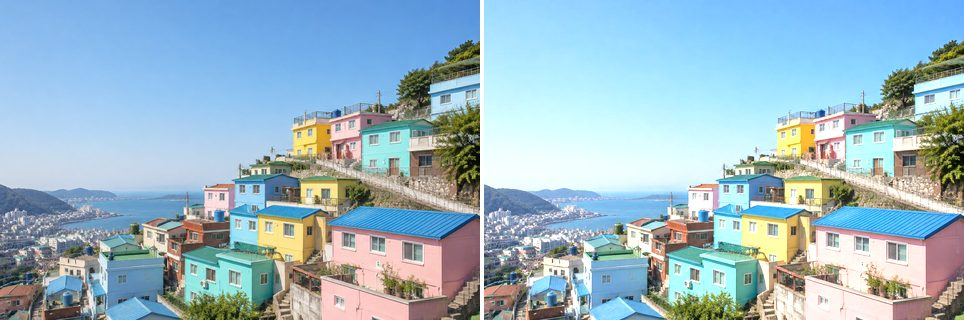

#### Contrast

Expand or compress the range around mid-gray: a factor above 1 increases contrast, between 0 and 1 decreases it.

```python
image.contrast(1.5)
```

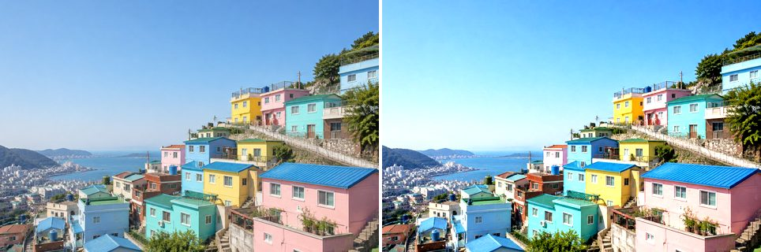

#### Hue

Set every pixel's hue to the target value in [0, 1] while keeping saturation and value. This is a colorize-style adjustment.

```python
image.hue(0.3)
```

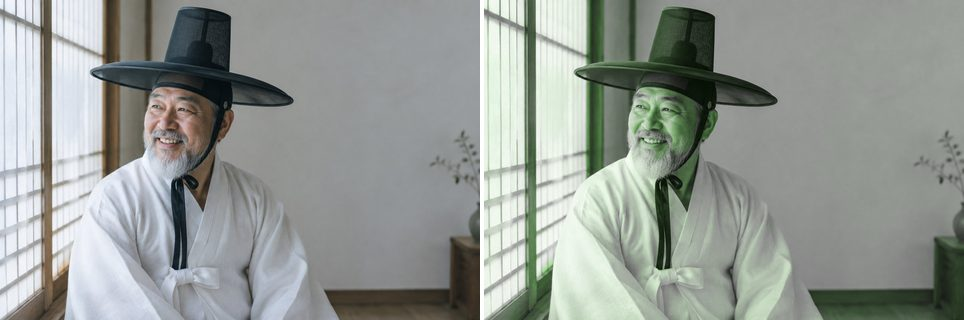

#### Saturation

Scale color intensity: a factor above 0 boosts saturation, below 0 mutes it (-1 fully desaturates).

```python
image.saturation(-0.5)
```


#### Lightness

Blend toward white (factor above 0) or black (factor below 0).

```python
image.lightness(0.4)
```

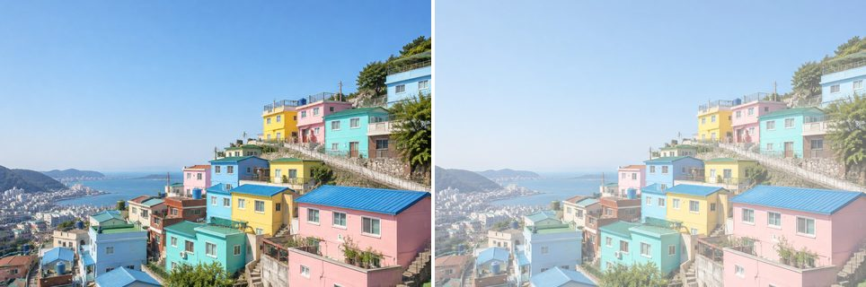

#### Curve (all channels)

Remap tones through control points spaced evenly across [0, 1]. Here, an S-curve deepens shadows and lifts highlights.

```python
image.curve('rgb', [0, 0.1, 0.4, 0.65, 0.9, 1])
```

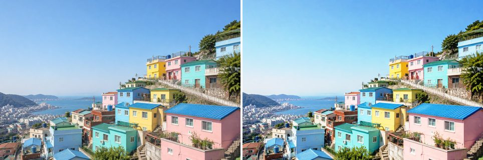

#### Curve (single channel)

The same curve machinery applied to the red channel only.

```python
image.curve('r', [0, 0.2, 0.8, 1])
```

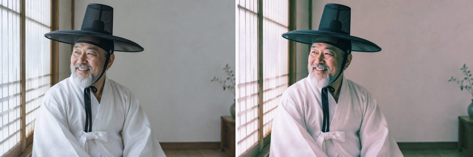

#### Resize

Resize with high-quality Lanczos resampling.

```python
image.resize(width=240, height=160)
```

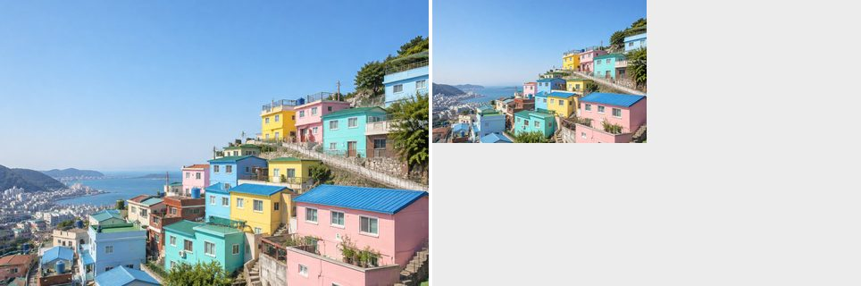

### Blend modes: darken

Blend modes accept a hex color string or a NumPy array, plus an optional `opacity` (0.0 to 1.0). The darken-group examples are applied to a grayscale base (`grayscale_image = image.clone().grayscale()`), as in the original demo.

#### Darken

Looks at the color information in each channel and selects the base or blend color, whichever is darker, as the result color.

```python
grayscale_image.darken('#3fe28f')
```

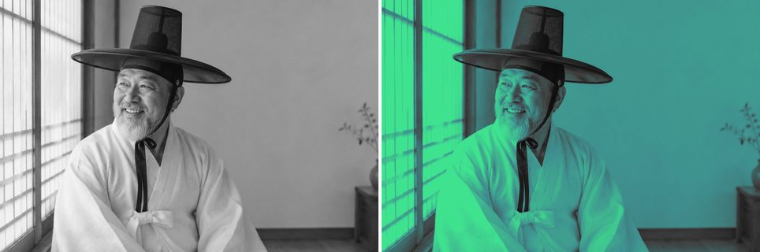

#### Multiply

Multiplies the base color by the blend color. The result is always darker; multiplying with white leaves the color unchanged.

```python
grayscale_image.multiply('#3fe28f')
```

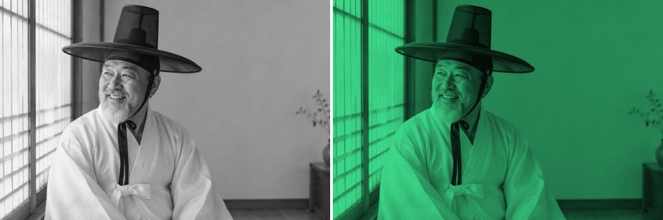

#### Color Burn

Darkens the base color to reflect the blend color by increasing the contrast between the two. Blending with white produces no change.

```python
grayscale_image.color_burn('#7fe3f8')
```

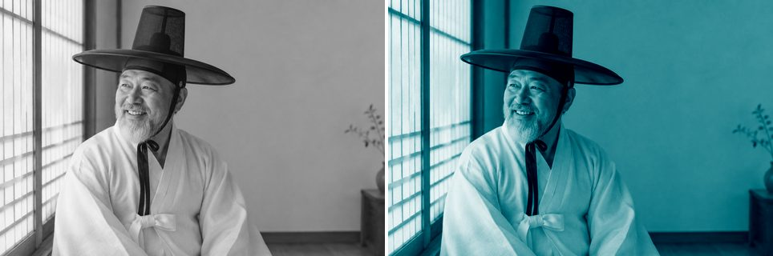

#### Linear Burn

Darkens the base color to reflect the blend color by decreasing the brightness. Blending with white produces no change.

```python
grayscale_image.linear_burn('#e1a8ff')
```


### Blend modes: lighten

#### Lighten

Selects the base or blend color, whichever is lighter, as the result color.

```python
image.lighten('#ff3ce1')
```

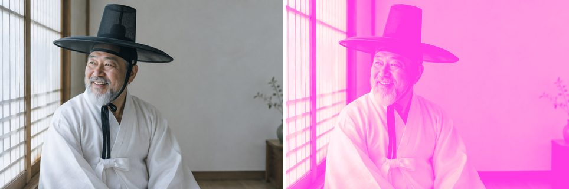

#### Screen

Multiplies the inverse of the blend and base colors. The result is always lighter, like projecting multiple slides on top of each other.

```python
image.screen('#e633ba')
```


#### Color Dodge

Brightens the base color to reflect the blend color by decreasing contrast between the two. Blending with black produces no change.

```python
image.color_dodge('#490cc7')
```

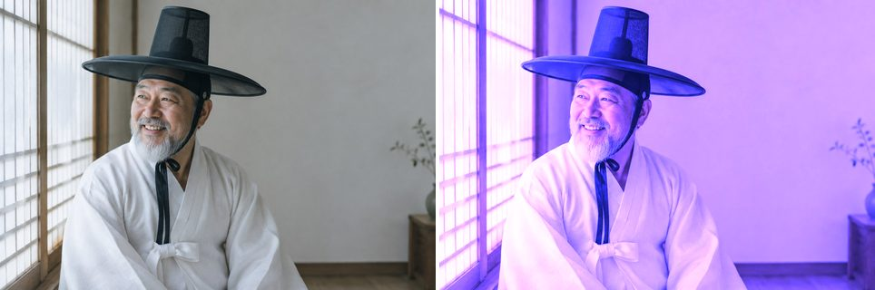

#### Linear Dodge

Brightens the base color to reflect the blend color by increasing the brightness. Blending with black produces no change.

```python
image.linear_dodge('#490cc7')
```

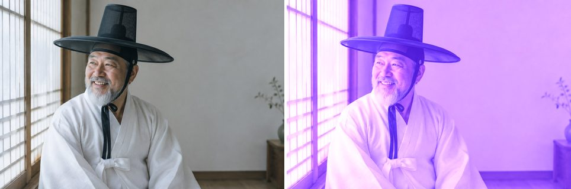

### Blend modes: contrast

#### Overlay

Multiplies or screens the colors depending on the base color, preserving its highlights and shadows.

```python
image.overlay('#ffb956')
```

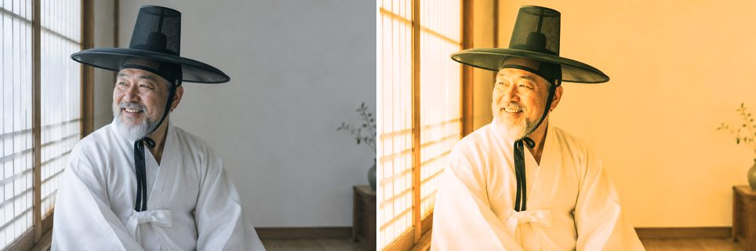

#### Soft Light

Darkens or lightens depending on the blend color, like shining a diffused spotlight on the image.

```python
image.soft_light('#ff3cbc')
```

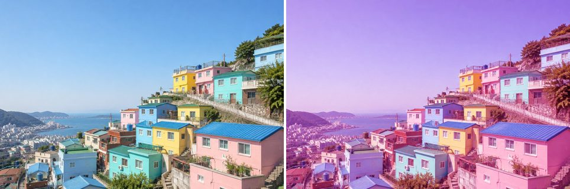

#### Hard Light

Multiplies or screens depending on the blend color, like shining a harsh spotlight on the image.

```python
image.hard_light('#df5dff')
```

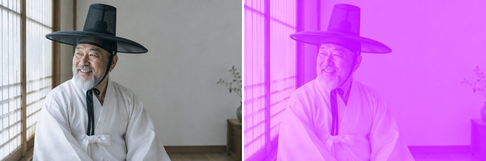

#### Vivid Light

Burns or dodges by increasing or decreasing the contrast, depending on the blend color.

```python
image.vivid_light('#ac5b7f')
```

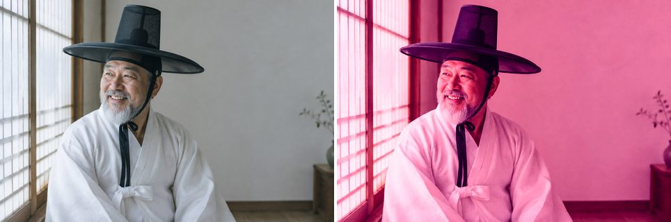

#### Linear Light

Burns or dodges by decreasing or increasing the brightness, depending on the blend color.

```python
image.linear_light('#9fa500')
```

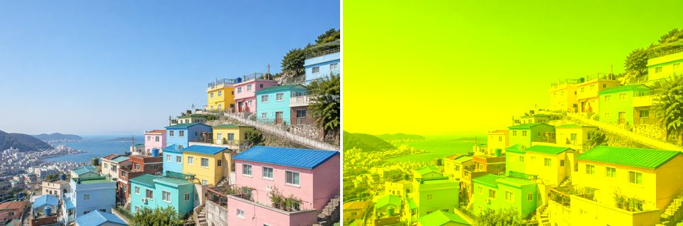

#### Pin Light

Replaces colors depending on the blend color, which is useful for adding special effects to an image.

```python
image.pin_light('#005546')
```

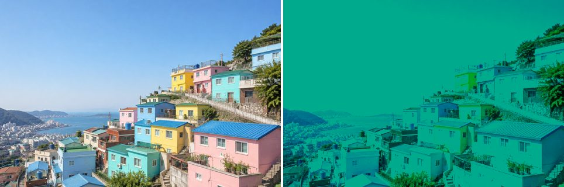

### Putting it together

#### Method chaining

Every operation returns the LayerImage itself, so a whole look can be built as one chained pipeline.

```python
(image.grayscale()
      .brightness(0.1)
      .multiply('#3fe28f', opacity=0.7)
      .curve('rgb', [0, 0.1, 0.4, 0.65, 0.9, 1]))
```

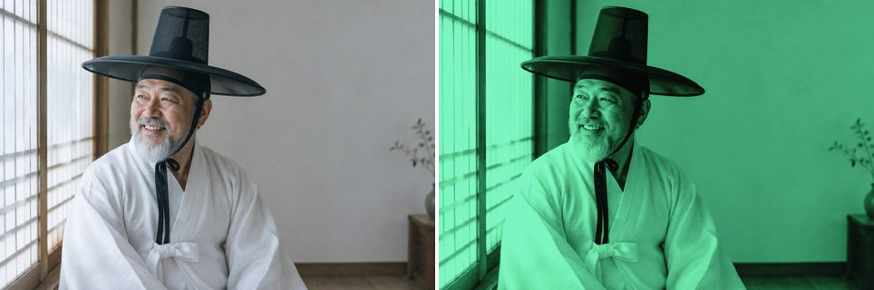


---

## More usage

### Get image data as a NumPy array

```python
arr = image.get_image_as_array()
# arr.shape  -> (height, width, 3)  for RGB
#            -> (height, width, 4)  for RGBA
# arr.dtype  -> float64
# values in [0.0, 1.0]
```

### Performance

Photos loaded with `from_file()` or `from_url()` stay as 8-bit images while
you apply per-channel operations: `brightness`, `contrast`, `lightness`,
`curve` and every blend mode with a hex color. Each of these only depends on
a pixel's own channel value, and an 8-bit channel has just 256 possible
values, so instead of processing every pixel, layeris updates a 256-entry
lookup table. Pillow applies the table in one pass when you call `resize()`
or `save()`.

`get_image_as_array()`, `grayscale()`, `hue()`, `saturation()` and blending
with a per-pixel NumPy array need float pixels, so they convert the image to
float64 once and later operations run in float64. Either way, the results are
identical to processing every pixel in float64.

On a 12-megapixel JPEG, loading it, applying a curve, brightness, contrast and
an overlay, then saving takes about 0.2 s instead of 4.1 s, and peak memory
drops from about 1.2 GB to under 200 MB.

### Apply operations from a dictionary or JSON file

Operations can be described as a Python dict (or a JSON file) and applied in sequence:

```python
ops = {
    "operations": [
        {"type": "grayscale"},
        {"type": "brightness", "factor": 0.15},
        {"type": "multiply", "hex": "#3fe28f", "opacity": 0.6},
        {"type": "curve", "channels": "rgb", "curve_points": [0, 0.1, 0.9, 1]},
        {"type": "resize", "width": 800, "height": 600},
    ]
}

image.apply_from_dict(ops)

# Or load directly from a JSON file
image.apply_from_json('pipeline.json')
```

Supported operation types: `grayscale`, `resize`, `brightness`, `contrast`, `hue`,
`saturation`, `lightness`, `curve`, `darken`, `multiply`, `color_burn`,
`linear_burn`, `lighten`, `screen`, `color_dodge`, `linear_dodge`, `overlay`,
`soft_light`, `hard_light`, `vivid_light`, `linear_light`, `pin_light`.

---

## Running tests

Install development dependencies and run the test suite with pytest:

```sh
# Using pip (editable install with dev extras)
pip install -e ".[dev]"
pytest

# Using hatch
hatch run test

# With coverage report
hatch run test-cov
```

Run a specific test file or test:

```sh
pytest tests/test_layer_image.py
pytest tests/test_utils.py
pytest tests/test_layer_image.py::TestBlendModes::test_multiply_by_white_no_change -v
```

Test images used by the suite are stored in `tests/images/`.

---

## Blend mode reference

| Group    | Method          | Formula (A = base, B = blend)                         |
|----------|-----------------|-------------------------------------------------------|
| Darken   | `darken`        | `min(A, B)`                                           |
| Darken   | `multiply`      | `A * B`                                               |
| Darken   | `color_burn`    | `1 - (1 - A) / B`                                    |
| Darken   | `linear_burn`   | `A + B - 1`                                           |
| Lighten  | `lighten`       | `max(A, B)`                                           |
| Lighten  | `screen`        | `1 - (1 - A)(1 - B)`                                 |
| Lighten  | `color_dodge`   | `A / (1 - B)`                                        |
| Lighten  | `linear_dodge`  | `A + B`                                               |
| Contrast | `overlay`       | `2AB` if A <= 0.5 else `1 - 2(1-A)(1-B)`             |
| Contrast | `soft_light`    | Pegtop formula                                        |
| Contrast | `hard_light`    | `2AB` if B <= 0.5 else `1 - 2(1-A)(1-B)`             |
| Contrast | `vivid_light`   | Color burn / dodge based on B                         |
| Contrast | `linear_light`  | `A + 2B - 1`                                          |
| Contrast | `pin_light`     | Conditional replace                                   |

All results are clamped to `[0, 1]`.

---

## Docs site (GitHub Pages)

The [`docs/`](docs/) folder is a static site with five pages:

| Page | Contents |
|------|----------|
| `index.html` | Overview: a live "look switcher", installation, quick start and performance notes |
| `examples.html` | 24 photo recipes (fixes, color grading, film, B&W, creative effects) with before/after sliders, copy-paste code and a filter by method |
| `blend-modes.html` | All 14 blend modes on three photos, plus opacity and blend-color comparisons |
| `operations.html` | The operation gallery above |
| `api.html` | API reference: signatures, parameters and return values for every method, and the JSON operation types |

Rebuild every page and image with:

```sh
python scripts/build_docs.py
```

Recipes live in [`scripts/docs_examples.py`](scripts/docs_examples.py). Each
snippet is executed verbatim to render its image, so the code on the page is
always exactly what produced the result. The API reference lives in
[`scripts/docs_api.py`](scripts/docs_api.py); the build fails if a public
`LayerImage` method is missing from it. The sample photos in
[`docs/photos/`](docs/photos/) were generated with OpenAI's
`gpt-image-2.5-flare` model at low quality; the prompts are kept in
[`scripts/generate_photos.py`](scripts/generate_photos.py), which can
regenerate them (requires `OPENAI_API_KEY`).

To publish, enable **Settings > Pages > Deploy from a branch** and select the
`main` branch with the `/docs` folder. No build step is needed on GitHub's
side.

---

## Roadmap

- Imitate Photoshop's auto brightness & auto contrast features
- Add filter presets

---

## Background

Layer.is won 2nd place (the Gold Prize and NIPA President's Award) in the general division of the [2019 Open Source Software Developer Competition](https://www.nipa.kr/home/bsnsAll/1/nttDetail?tab=2&bbsNo=4&bsnsDtlsIemNo=58&nttNo=16815), the competition's 13th edition, in which over 100 teams took part. The competition was hosted by Korea's Ministry of Science and ICT and organized by NIPA (National IT Industry Promotion Agency).
